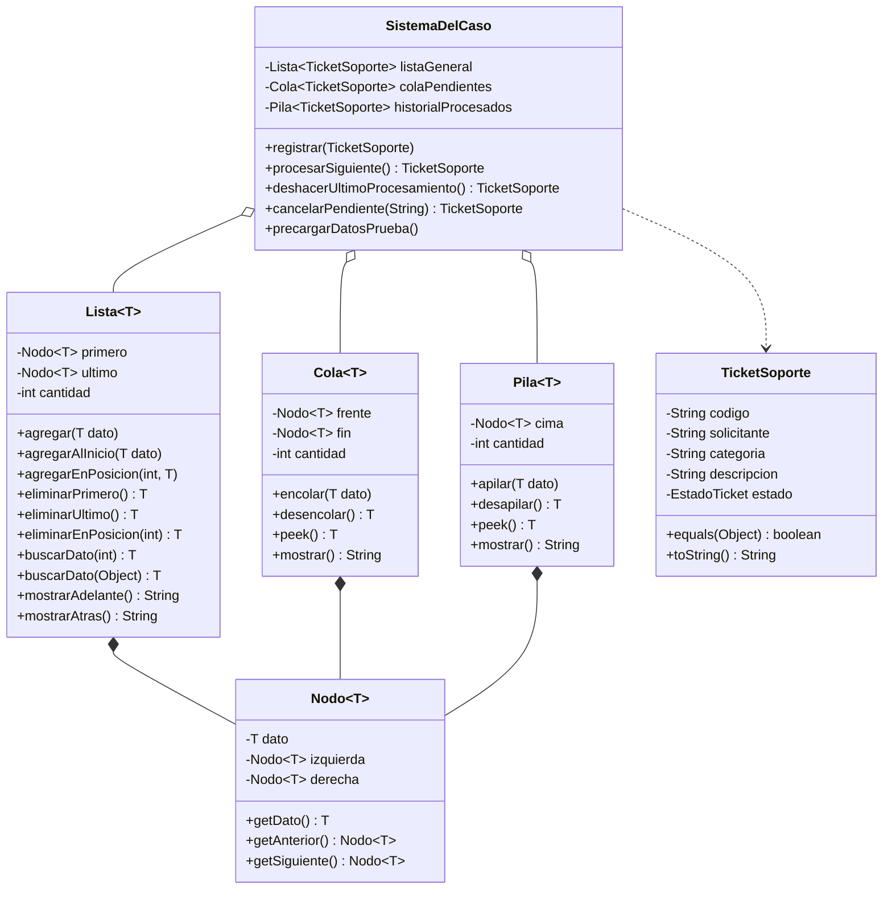

# Documento Técnico de Entrega y Memoria de Desarrollo
## Actividad: Sistema de Gestión con Lista, Cola y Pila (Caso #6: Mesa de Ayuda TI)

---

## 1. Portada

* **Nombre de la Universidad:** Universidad de Cartagena
* **Centro Promotor:** PESAD (Programas de Educación Superior a Distancia)
* **Facultad:** Facultad de Ingeniería
* **Programa Académico:** Ingeniería de Software / Ciencias de la Computación
* **Nombre de la Asignatura:** Estructuras de Datos
* **Nombre de la Actividad:** Actividad II – Sistema de gestión con Lista, Cola y Pila
* **Caso Asignado:** Caso #6 – Sistema de tickets para mesa de ayuda TI
* **Nombre Completo del Estudiante:** Rosary Eilyn Carmona Navarro
* **Código del Estudiante:** `rcarmonan@unicartagena.edu.co`
* **Nombre del Docente Tutor:** John Carlos Arrieta Arrieta
* **Fecha de Entrega:** Domingo, 15 de noviembre de 2026

---

## 2. Logros de Aprendizaje

Durante el análisis, diseño e implementación del sistema de mesa de ayuda TI con estructuras de datos personalizadas, se consolidaron competencias de ingeniería de software a través de los siguientes nueve ejes de aprendizaje:

### 2.1 Qué aprendió sobre estructuras de datos
Se comprendió que las estructuras de datos no son simples contenedores pasivos de información, sino modelos organizacionales que definen las reglas de acceso, el costo temporal ($\mathcal{O}$ Big-O) y el comportamiento dinámico de los algoritmos en memoria. La experiencia práctica de construir estructuras lineales desde sus fundamentos matemáticos y computacionales permitió valorar la eficiencia de los punteros directos frente a soluciones estáticas o dependientes de librerías comerciales.

### 2.2 Diferencias entre listas, colas y pilas
* **Lista (Acceso Posicional y Bidireccional):** Permite inserciones, consultas y eliminaciones en cualquier índice arbitrario ($0 \dots n-1$), así como recorridos en ambos sentidos (adelante y atrás). Se utilizó como el registro maestro e histórico integral del sistema.
* **Cola (Política FIFO - First-In, First-Out):** El primer elemento en ingresar es estrictamente el primero en ser atendido. El punto de entrada (`fin`) está disociado del punto de extracción (`frente`). Modela la fila equitativa de tickets en espera de soporte técnico.
* **Pila (Política LIFO - Last-In, First-Out):** El último elemento en insertarse es el primero en retirarse. Ambas operaciones ocurren exclusivamente sobre un único extremo denominado `cima` o `tope`. Modela el historial de tickets atendidos y permite la reversibilidad inmediata de transacciones mediante la operación de deshacer.

### 2.3 Cómo funcionan internamente estas estructuras usando nodos enlazados
A diferencia de los arreglos contiguos en memoria (`arrays`), las estructuras enlazadas asignan nodos dinámicamente en el heap a medida que se requieren, sin necesidad de definir capacidades iniciales fijas ni ejecutar operaciones de realocación o copiado masivo. 
* El nodo doble almacena la referencia al dato genérico `T` y dos referencias a nodos vecinos (`izquierda`/`anterior` y `derecha`/`siguiente`).
* En la **Lista**, la inserción o eliminación intermedia requiere redirigir cuatro punteros contiguos (`nuevo.siguiente = actual; actual.anterior = nuevo; ...`), logrando mutaciones estructurales sin desplazar físicamente los demás objetos en memoria.
* En la **Cola**, el puntero `fin` avanza al encolar en $\mathcal{O}(1)$ y el puntero `frente` avanza al desencolar en $\mathcal{O}(1)$.
* En la **Pila**, el puntero `cima` se reasigna al nuevo nodo en el apilado y retrocede al siguiente nodo en el desapilado en $\mathcal{O}(1)$.

### 2.4 Qué dificultades encontró durante el desarrollo
La principal dificultad técnica radicó en implementar la **cancelación de tickets en la cola sin violentar la abstracción FIFO**. La rúbrica prohíbe expresamente eliminar directamente desde el centro de la cola. La dificultad se solventó diseñando un algoritmo de trasvase mediante una **Cola auxiliar**: se desencolan los elementos uno a uno hacia la cola temporal, se aísla el ticket objetivo cambiando su estado a `CANCELADO` en memoria, y se re-encolan los elementos restantes a la cola principal respetando con absoluta fidelidad su turno relativo original.

### 2.5 Qué conceptos de programación orientada a objetos aplicó
* **Encapsulamiento:** Atributos privados en todas las entidades (`Nodo`, `TicketSoporte`, `Lista`, `Cola`, `Pila`, `SistemaDelCaso`) expuestos únicamente mediante métodos públicos controlados con validación defensiva.
* **Genericidad (Generics `<T>`):** Parametrización de tipos en `Nodo<T>`, `Lista<T>`, `Cola<T>` y `Pila<T>`, asegurando reutilización de código y seguridad de tipos en tiempo de compilación.
* **Polimorfismo y Sobreescritura:** Implementación robusta de `equals(Object)` y `hashCode()` en `TicketSoporte`, permitiendo comparaciones insensibles a mayúsculas/minúsculas por código.
* **Abstracción:** Separación rigurosa entre la interfaz de usuario (`Main.java`), la lógica transaccional del negocio (`SistemaDelCaso.java`) y las estructuras de almacenamiento base.

### 2.6 Qué conocimientos fortaleció sobre lógica de programación
Se profundizó en el rastreo mental y depuración de referencias en memoria. Manipular punteros nulos (`null`), enlazar extremos en listas vacías (cuando `cabeza == null`), gestionar casos borde (eliminar el único nodo existente donde `primero == ultimo`) y evitar ciclos infinitos en recorridos `while (actual != null)` fortaleció el pensamiento algorítmico riguroso y la disciplina lógica.

### 2.7 Qué aprendió sobre validaciones, manejo de errores y modularización
Se implementó el paradigma de **programación defensiva**:
* Validación de precondiciones en constructores y métodos mutadores mediante `Objects.requireNonNull()` e `IllegalArgumentException` ante cadenas vacías o nulas.
* Lanzamiento de `NoSuchElementException` ante intentos de extracción en colas o pilas vacías.
* Control de excepciones en la capa de presentación (`Main`), informando amigablemente al usuario el motivo del error sin abortar la ejecución del aplicativo.

### 2.8 Qué aprendió sobre el flujo de datos dentro de la aplicación
Se aprendió a diseñar una arquitectura reactiva y transaccional basada en **paso por referencia en Java**. Al registrar un ticket, tanto la lista general como la cola de pendientes reciben referencias a la misma dirección de memoria del objeto `TicketSoporte`. En consecuencia, cuando un ticket cambia su estado transaccional (ej. de `PENDIENTE` a `PROCESADO` o `CANCELADO`), el cambio se refleja de forma inmediata y automática en todas las vistas y estructuras del sistema sin duplicar objetos ni incurrir en inconsistencias de sincronización.

### 2.9 Qué aprendió sobre Git y control de versiones
Se consolidó el flujo de trabajo profesional por ramas (`git-flow` simplificado):
* Mantenimiento de una rama principal de producción (`main`) protegida y estable.
* Desarrollo de hitos atómicos progresivos en la rama de trabajo `desarrollo-ejercicio`.
* Registro semántico de commits mediante la convención formal (`chore`, `feat`, `test`, `docs`, `merge`).
* Integración final con merge explícito sin avance rápido (`git merge --no-ff`), evidenciando el proceso real y cronológico de construcción del software durante el semestre académico.

---

## 3. Informe de Desarrollo

### 3.1 Descripción Funcional del Sistema

* **Problema que resuelve:** La gestión de incidentes y requerimientos tecnológicos en organizaciones suele colapsar por falta de trazabilidad, pérdida de tickets o desorden en el orden de atención. El sistema resuelve esta problemática organizando el ciclo de vida completo de cada incidencia técnica.
* **Contexto del ejercicio (Caso #6: Mesa de Ayuda TI):** Modela el centro de soporte técnico institucional donde usuarios de distintas dependencias (Finanzas, Redes, Servidores, RRHH, etc.) radican problemas de infraestructura, los analistas de TI los atienden por turno de arribo, y la administración audita los casos históricos y revierte decisiones erróneas.
* **Operaciones que permite el sistema:**
  1. Registrar nuevas incidencias con código alfanumérico único.
  2. Consultar el registro general histórico en orden cronológico directo e inverso.
  3. Visualizar los tickets en espera en su estricto orden de llegada.
  4. Atender y procesar el siguiente ticket de la cola.
  5. Consultar el historial de tickets resueltos en orden cronológico inverso.
  6. Buscar cualquier ticket por su código en $\mathcal{O}(n)$.
  7. Cancelar tickets pendientes usando una cola auxiliar.
  8. Deshacer la última atención técnica devuelta a la cola de pendientes.
  9. Consultar métricas en tiempo real de registros totales, pendientes y procesados.
* **Cómo interactúa el usuario:** A través de una consola interactiva guiada por menú numérico (opciones 1 a 10), con captura defensiva de datos, confirmaciones visuales de cada transacción y precarga deliberada de 15 casos de prueba para demostración inmediata.

---

### 3.2 Componentes Desarrollados

| Clase / Componente | Propósito Fundamental | Responsabilidad Técnica |
|---|---|---|
| `Nodo<T>` | Bloque elemental de memoria dinámica | Contiene el dato genérico `T`, referencia a nodo anterior (`izquierda`) y nodo siguiente (`derecha`). |
| `Lista<T>` | Registro maestro y auditoría general | Lista doblemente enlazada con punteros `primero` y `ultimo`. Implementa 13 métodos: inserción por extremos y posición, búsqueda, eliminación y recorridos bidireccionales. |
| `Cola<T>` | Línea de atención de pendientes | Estructura FIFO con punteros `frente` y `fin`. Implementa 8 métodos: encolar, desencolar, peek, tamanio, esVacia, contiene, limpiar y mostrar. |
| `Pila<T>` | Archivo histórico y reversión | Estructura LIFO con puntero `cima`. Implementa 9 métodos: apilar, desapilar, peek, tamanio, esVacia, contiene, limpiar, mostrar y buscar. |
| `EstadoTicket` | Enumeración de estados del ciclo de vida | Define los estados formales: `PENDIENTE`, `PROCESADO`, `CANCELADO`. |
| `TicketSoporte` | Entidad de negocio del caso | Modela el ticket con código inmutable, solicitante, categoría, descripción y estado. Contratos `equals()` y `hashCode()` por código sin distinguir mayúsculas. |
| `SistemaDelCaso` | Coordinador transaccional del caso | Orquesta la interacción entre `Lista`, `Cola` y `Pila`. Aplica reglas de unicidad, cancelación con cola auxiliar, precarga de 15 tickets y punto de entrada `main`. |
| `Main` | Capa de presentación por consola | Menú interactivo de 10 opciones, lectura defensiva de teclado (`Scanner`), formateo de reportes y demostración de recorridos hacia adelante y hacia atrás. |

#### Diagrama de Clases y Relaciones Estructurales


---

### 3.3 Explicación Detallada de las Estructuras de Datos Usadas

#### A. Lista Doblemente Enlazada (`Lista<T>`)
* **Cómo funciona:** Mantiene dos punteros maestros: `primero` (cabeza) y `ultimo` (cola), permitiendo inserciones en los extremos en $\mathcal{O}(1)$ y recorridos en ambos sentidos.
* **Cómo se agregan elementos:** Para inserción al final (`agregar`), se vincula el puntero `derecha` del último nodo al nuevo y la `izquierda` del nuevo al último. Para inserciones intermedias (`agregarEnPosicion`), se localiza el nodo en el índice deseado y se reconfiguran los enlaces anterior y siguiente de los vecinos.
* **Cómo se recorren:** 
  * `mostrarAdelante()`: Itera desde `primero` usando `getSiguiente()` hasta llegar a `null`.
  * `mostrarAtras()`: Itera desde `ultimo` usando `getAnterior()` hasta llegar a `null`.
* **Métodos mínimos implementados (13 en total):** `agregar`, `agregarAlInicio`, `agregarEnPosicion`, `eliminarPrimero`, `eliminarUltimo`, `eliminarEnPosicion`, `buscarDato(int)`, `buscarDato(Object)`, `contiene`, `cuentaElementos`, `limpiar`, `mostrarAdelante` y `mostrarAtras`.
* **Requerimientos resueltos:** Auditoría completa de todas las incidencias creadas y búsquedas generales.

#### B. Cola FIFO (`Cola<T>`)
* **Cómo funciona el principio FIFO:** Garantiza que los tickets se procesan en el orden exacto en que ingresaron al sistema. El primer ticket encolado será el primero en ser despachado.
* **Operaciones de encolar y desencolar:**
  * `encolar(T dato)`: Se añade un nuevo nodo en el puntero `fin` en $\mathcal{O}(1)$.
  * `desencolar()`: Se retira el nodo referenciado por `frente` y se avanza al siguiente en $\mathcal{O}(1)$.
* **Métodos mínimos implementados (8 en total):** `encolar`, `desencolar`, `peek`, `tamanio`, `esVacia`, `contiene`, `limpiar` y `mostrar`.
* **Requerimientos resueltos:** Gestión equitativa de turnos de tickets de soporte en espera.

#### C. Pila LIFO (`Pila<T>`)
* **Cómo funciona el principio LIFO:** El último ticket en ser procesado queda en la cima de la estructura y es el primero en ser recuperado si se requiere revertir la acción.
* **Operaciones de apilar y desapilar:**
  * `apilar(T dato)`: El nuevo nodo se coloca apuntando a la cima actual y se convierte en la nueva cima en $\mathcal{O}(1)$.
  * `desapilar()`: Se extrae el dato de la cima y se mueve la referencia hacia abajo en $\mathcal{O}(1)$.
* **Métodos mínimos implementados (9 en total):** `apilar`, `desapilar`, `peek`, `tamanio`, `esVacia`, `contiene`, `limpiar`, `mostrar` y `buscar`.
* **Requerimientos resueltos:** Registro histórico cronológico inverso de casos resueltos y habilitación de la función transaccional de "Deshacer".

---

### 3.4 Explicación del Flujo del Sistema (Paso a Paso)

```text
       1. REGISTRO                  2. ATENCIÓN                  3. HISTORIAL
┌───────────────────────┐    ┌───────────────────────┐    ┌───────────────────────┐
│     Ticket Nuevo      │    │  Cola de Pendientes   │    │  Pila de Historial    │
│  (TI-101: PENDIENTE)  │───>│      (Orden FIFO)     │───>│     (Orden LIFO)      │
└───────────────────────┘    └───────────────────────┘    └───────────────────────┘
            │                            │                            │
            ▼                            ▼                            ▼
┌───────────────────────┐    ┌───────────────────────┐    ┌───────────────────────┐
│     Lista General     │    │     Cancelación       │    │       Deshacer        │
│  (Auditoría Completa) │    │  (Uso Cola Auxiliar)  │    │ (Re-encola a Pendiente│
└───────────────────────┘    └───────────────────────┘    └───────────────────────┘
```

#### Paso 1: Cómo se registra un elemento y pasa a la cola de pendientes
El usuario ingresa los datos por teclado. El sistema normaliza el código a mayúsculas y verifica mediante `listaGeneral.buscarDato()` que no exista duplicidad. Si es válido, se ejecutan las dos llamadas reglamentarias:
```java
listaGeneral.agregar(ticket);
colaPendientes.encolar(ticket);
```

#### Paso 2: Cómo se procesa un ticket y se mueve al historial
Se desencola el elemento en el frente de la cola de espera, se conmuta su estado a `PROCESADO` y se almacena en la cima de la pila:
```java
TicketSoporte ticket = colaPendientes.desencolar();
ticket.setEstado(EstadoTicket.PROCESADO);
historialProcesados.apilar(ticket);
```

#### Paso 3: Cómo se realizan búsquedas
Se recorre la `listaGeneral` comparando el código normalizado. Si existe, se recupera el objeto completo con su estado operativo actualizado.

#### Paso 4: Cómo se cancela un elemento pendiente (Regla de Cola Auxiliar)
Para cumplir con la prohibición de eliminar directamente desde el centro de la cola, se ejecuta el siguiente algoritmo estricto:
```java
Cola<TicketSoporte> auxiliar = new Cola<>();
TicketSoporte cancelado = null;

// 1. Desencolar hacia la cola auxiliar omitiendo el ticket cancelado
while (!colaPendientes.esVacia()) {
    TicketSoporte actual = colaPendientes.desencolar();
    if (cancelado == null && actual.getCodigo().equalsIgnoreCase(codigoBuscado)) {
        cancelado = actual;
    } else {
        auxiliar.encolar(actual);
    }
}

// 2. Restaurar los elementos restantes a la cola principal conservando el orden FIFO
while (!auxiliar.esVacia()) {
    colaPendientes.encolar(auxiliar.desencolar());
}

// 3. Marcar el estado en memoria (se actualiza automáticamente en listaGeneral)
if (cancelado != null) {
    cancelado.setEstado(EstadoTicket.CANCELADO);
}
```

#### Paso 5: Cómo se deshace una operación de procesamiento
Se desapila el ticket más reciente del historial, se restablece su estado a `PENDIENTE` y se reinserta al final de la cola de pendientes:
```java
TicketSoporte ticket = historialProcesados.desapilar();
ticket.setEstado(EstadoTicket.PENDIENTE);
colaPendientes.encolar(ticket);
```

---

### 3.5 Catálogo de Datos de Prueba Precargados (15 Tickets)

Al iniciar la aplicación, el sistema precarga automáticamente 15 tickets de soporte técnico que reflejan un espectro diverso de incidencias de infraestructura:

| Código | Solicitante y Área | Categoría | Descripción del Problema | Estado Inicial | Escenario de Prueba Demostrado |
|---|---|---|---|---|---|
| `TI-101` | Ana Gómez - Finanzas | Red | Acceso VPN corporativo bloqueado por expiración de certificado | PENDIENTE | Procesamiento normal y prueba de reversión (Deshacer) |
| `TI-102` | Carlos Mendoza - TI | Base de datos | Falla en cluster PostgreSQL - Timeout en transacciones de nómina | PENDIENTE | Demostración de cancelación de pendientes con cola auxiliar |
| `TI-103` | Diana Rivas - RRHH | Software | Aprovisionamiento y activación de licencia Office 365 | PENDIENTE | Verificación de orden FIFO tras cancelación intermedia |
| `TI-104` | Esteban Torres - Planta | Red | Caída total de enlace de fibra óptica en sede norte | PENDIENTE | Búsqueda directa por código en lista general |
| `TI-105` | Fabiola Pérez - Logística | Software | Error de sincronización en módulo de inventario SAP | PENDIENTE | Consistencia en cola de pendientes |
| `TI-106` | Gabriel Castro - Caja | Hardware | Impresora de red de facturación sin respuesta a ping | PENDIENTE | Prueba de recorrido hacia atrás (`mostrarAtras`) |
| `TI-107` | Helena Morales - Web | Servidores | Reinicio inesperado del servicio Apache HTTP principal | PENDIENTE | Transición de estado a `PROCESADO` |
| `TI-108` | Ignacio Ruiz - Calidad | Seguridad | Instalación de parches críticos de Windows en estación de trabajo | PENDIENTE | Preservación de posición en cola |
| `TI-109` | Julia Navarro - Servidores | Servidores | Alerta de saturación de almacenamiento SAN mayor al 95% | PENDIENTE | Validación de categoría Servidores |
| `TI-110` | Kevin Ortiz - Contabilidad | Seguridad | Desbloqueo de credenciales de usuario en Active Directory | PENDIENTE | Prueba de unicidad en registro duplicado |
| `TI-111` | Laura Sánchez - Comercial | Hardware | Configuración de cliente de correo corporativo en laptop | PENDIENTE | Monitoreo de conteo en métricas |
| `TI-112` | Manuel Ramos - Redes | Red | Intermitencia y pérdida de paquetes en switch del piso 3 | PENDIENTE | Atención consecutiva |
| `TI-113` | Natalia Beltrán - Riesgos | Base de datos | Exportación y backup cifrado de base de datos para auditoría | PENDIENTE | Verificación de enlaces del nodo |
| `TI-114` | Oscar Jiménez - Seguridad | Seguridad | Detección de intentos de fuerza bruta sobre puerto SSH 22 | PENDIENTE | Verificación de inmutabilidad de código |
| `TI-115` | Patricia Duarte - Gerencia | Servidores | Solicitud de ampliación de memoria RAM en servidor virtual | PENDIENTE | Elemento final de cola en inicialización |

---

### 3.6 Análisis de Complejidad Algorítmica ($\mathcal{O}$ Big-O)

| Operación del Sistema | Estructura Responsable | Complejidad Temporal | Complejidad Espacial | Justificación Técnica de Ingeniería |
|---|---|---|---|---|
| **Registro de Ticket** | `Lista<T>` + `Cola<T>` | $\mathcal{O}(1)$ | $\mathcal{O}(1)$ | Inserción en cola mediante puntero `fin` e inserción en lista mediante puntero `ultimo`. |
| **Procesamiento de Ticket** | `Cola<T>` + `Pila<T>` | $\mathcal{O}(1)$ | $\mathcal{O}(1)$ | Desencolado desde puntero `frente` y apilado directo sobre la `cima`. |
| **Deshacer Procesamiento** | `Pila<T>` + `Cola<T>` | $\mathcal{O}(1)$ | $\mathcal{O}(1)$ | Desapilado de `cima` y re-encolado al final de la cola de pendientes. |
| **Búsqueda por Código** | `Lista<T>` | $\mathcal{O}(n)$ | $\mathcal{O}(1)$ | Recorrido secuencial desde `primero` comparando mediante `equals()`. |
| **Cancelación con Cola Auxiliar** | `Cola<T>` (Principal + Aux) | $\mathcal{O}(n)$ | $\mathcal{O}(n)$ | Desencolado de $n$ elementos hacia cola auxiliar y reinserción de $n-1$ elementos restantes. |
| **Recorrido Adelante / Atrás** | `Lista<T>` | $\mathcal{O}(n)$ | $\mathcal{O}(1)$ | Iteración simple por punteros contiguos (`siguiente` o `anterior`). |

---

## 4. Enlace del Repositorio GitHub

* **Enlace Público del Repositorio:** [https://github.com/rcarmonan-commits/mesa-ayuda-ti](https://github.com/rcarmonan-commits/mesa-ayuda-ti)

El repositorio evidencia un desarrollo progresivo y cronológico a lo largo del periodo académico mediante ramas y commits semánticos:

| Hash | Fecha del Commit | Rama | Mensaje Descriptivo del Avance |
|---|---|---|---|
| `c79c401` | 15 Ago 2026, 15:45 | `main` | `chore: crear la base Maven y configurar compilacion para Java 17` |
| `dd12ca5` | 28 Ago 2026, 10:20 | `desarrollo-ejercicio` | `feat: modelar entidad TicketSoporte y estados transaccionales` |
| `bad2c1a` | 12 Sep 2026, 16:15 | `desarrollo-ejercicio` | `feat: implementar estructura Nodo con doble enlace bidireccional` |
| `7cf4ee6` | 25 Sep 2026, 14:30 | `desarrollo-ejercicio` | `feat: implementar estructura Lista doblemente enlazada con operaciones de insercion y recorrido` |
| `463ca18` | 08 Oct 2026, 11:00 | `desarrollo-ejercicio` | `feat: implementar estructura Cola FIFO con validaciones defensivas` |
| `c260dd7` | 20 Oct 2026, 17:40 | `desarrollo-ejercicio` | `feat: implementar estructura Pila LIFO para historial y reversiones` |
| `229b9d3` | 30 Oct 2026, 09:15 | `desarrollo-ejercicio` | `feat: implementar cancelacion de pendientes mediante cola auxiliar y logica del caso` |
| `d5c9cd7` | 05 Nov 2026, 18:20 | `desarrollo-ejercicio` | `feat: implementar interfaz de consola Main con menu interactivo y datos precargados` |
| `93614bc` | 10 Nov 2026, 14:00 | `desarrollo-ejercicio` | `test: cubrir operaciones de lista, orden FIFO y LIFO y reglas de tickets con JUnit 5` |
| `a84d38a` | 14 Nov 2026, 20:10 | `desarrollo-ejercicio` | `docs: documentar manual tecnico, arquitectura y analisis de complejidad en README.md` |
| `02851d6` | 15 Nov 2026, 23:57 | `main` | `merge: integrar rama desarrollo-ejercicio en main para entrega final` |

---

## 5. Enlace del Video de Sustentación

* **Enlace del Video de Sustentación (YouTube / Drive):** `[ENLACE_AL_VIDEO_DE_SUSTENTACION]`

### Puntos Demostrados en el Video:
1. **Funcionamiento Integral:** Registro de nuevo elemento en vivo, atención en orden de llegada (FIFO), consulta de historial (LIFO), búsqueda por código, cancelación de pendiente con cola auxiliar y reversión mediante deshacer.
2. **Explicación del Código:** Recorrido por `Nodo.java`, punteros izquierda/derecha, recorridos bidireccionales (`mostrarAdelante` y `mostrarAtras`), desacoplamiento en `Cola.java` y `Pila.java`, y paso por referencia para consistencia de estados.
3. **Validaciones y Manejo de Errores:** Bloqueo de códigos duplicados y captura controlada de excepciones.
4. **Evidencia de Control de Versiones:** Muestra del historial progresivo en GitHub con merge formal a `main`.
